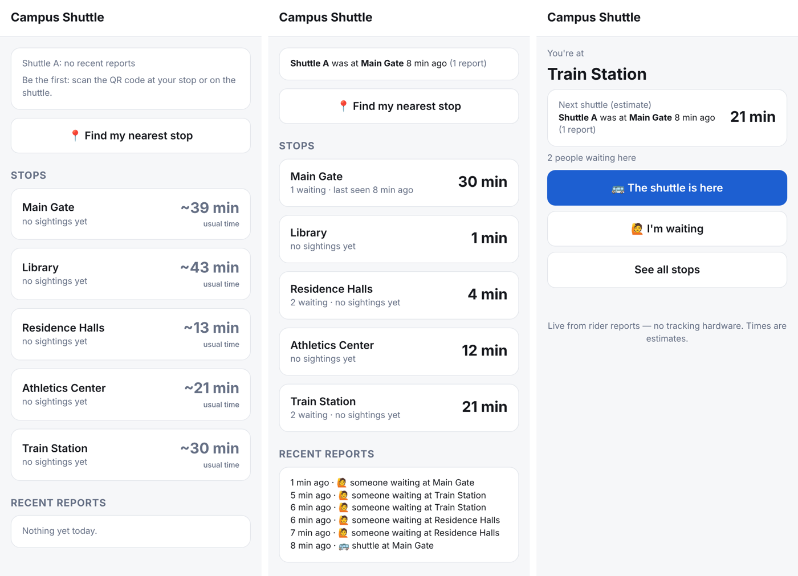

# Shuttle Tracker (QR-based, no tracking hardware)

Crowd-sourced live shuttle tracker. Riders scan QR codes; nothing is installed on the shuttle.

- **Stop QR** (`/s/<stop>`): see the ETA, tap **"The shuttle is here"** or **"I'm waiting"**.
- **Shuttle QR** (`/b/<shuttle>`): riders tap the stop they're at, or opt in to share their phone's location while riding (auto-stops after 30 min).
- **Home** (`/`): all stops with ETAs, people waiting, nearest stop, recent reports.
- **Print signs** (`/qr`): printable QR signs for every stop and shuttle.



## How ETAs work
- **Live:** last sighting (a tap, or a rider's GPS — including partway between stops) + drive times to each stop. Drive times are learned from today's sightings and past days' (by hour), starting from `config.json`.
- **Usual time (history):** with no live reports, the ETA is the median of when the shuttle came after this time of day on past days (weekdays/weekends separately). Confirmed arrivals are kept 60 days; stops nobody reported between two sightings are filled in.
- **Running late:** shows "1 min" (due) instead of jumping to the next loop, until it's clearly missed.
- Live position expires after `staleAfterMinutes`.

## Anti-abuse
- Per-device and per-IP rate limits, one report per device per stop every few minutes.
- Taps with location must be within 800 m of the stop; GPS must be near the route.
- A lone report the shuttle couldn't physically have made (e.g. 25 min away, 1 min later) is held until a 2nd person confirms it, and that phone is ignored for an hour.

## Tests & simulation
```bash
npm test          # unit tests
npm run sim       # simulate mornings (with traffic, riders, pranksters) and score ETA accuracy
npm run sim:live  # watch a simulated morning at 30x speed on http://localhost:3000
```

Sample `npm run sim` results (6 random mornings × 3 h, every stop checked every 30 s):

| scenario | has ETA | within ±2 min | within ±5 min | median error |
|---|---|---|---|---|
| Nobody reports, no history | 0% | — | — | — |
| Nobody reports today, 10 days history | 98% | 32% | 75% | 3.5 min |
| Low participation (10% tap) + history | 100% | 63% | 93% | 1.6 min |
| Typical (30% tap) + history | 100% | 67% | 96% | 1.4 min |
| Typical + 10% riders share GPS | 100% | 70% | 98% | 1.2 min |
| Typical + prankster (location off) | 100% | 62% | 90% | 1.5 min |

## Setup
1. Edit `config.json`: set `timezone`, then your stops **in route order** with real lat/lng (right-click in Google Maps to copy), and `minsFromPrev` = minutes driving from the previous stop (first stop = minutes from the last stop back to it). Add shuttles if there's more than one.
2. Run locally: `node server.js` (Node 20+, no dependencies) → http://localhost:3000
3. Deploy anywhere that runs Node (Render, Railway, Fly.io, a school server). Set `PORT` if needed. Data is stored in `data/` (`DATA_DIR` to change): raw reports for 24 h, confirmed arrivals for 60 days (`historyDays`). Use a host with a persistent disk so history survives restarts.
4. Open `https://<your-site>/qr` and print. Post stop signs at stops, shuttle signs inside shuttles.

Optional: set `ADMIN_KEY` and `POST /api/reset?key=...` to clear all reports.

`public/qrcode.js` is [qrcode-generator](https://github.com/kazuhikoarase/qrcode-generator) (MIT).
