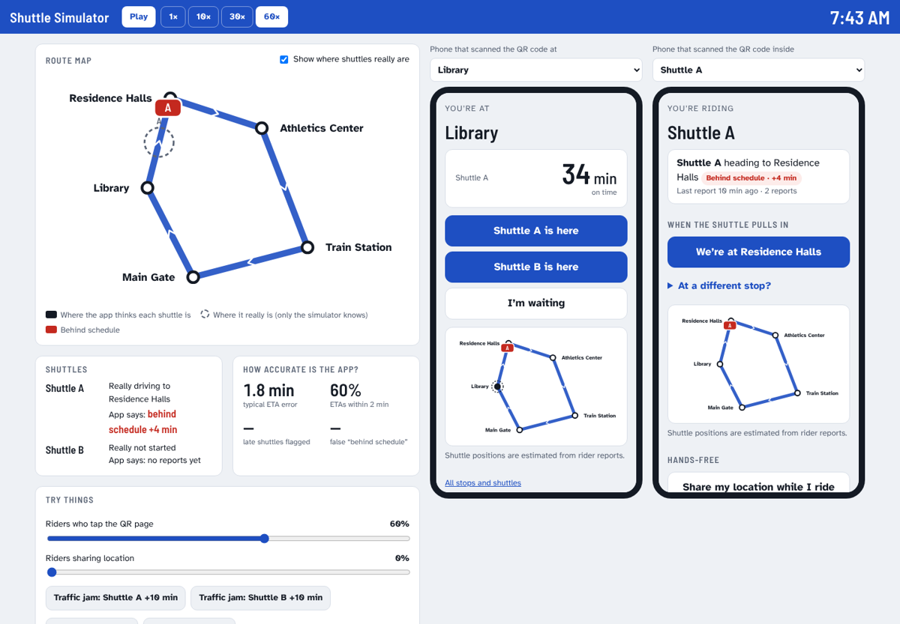

# Shuttle Tracker (QR codes, no tracking hardware)

A live shuttle tracker that runs on rider reports. Every stop and every shuttle gets its own QR code; scanning it opens the page for *that* place. Nothing is installed on the shuttles.



## What riders see

| QR code | Page | What it does |
|---|---|---|
| At a stop | `/s/<stop>` | **First thing on screen: when the next shuttle arrives** (big minutes + clock time), **red "Behind schedule"** when it's late, then buttons *Shuttle A is here* / *I'm waiting*, and the route map |
| Inside a shuttle | `/b/<shuttle>` | One big button for the stop it's pulling into next (*We're at Library*), other stops tucked away, optional hands-free location sharing |
| — | `/` | All stops and shuttles with the map (linked from the pages above) |

Nobody has to find their stop: the code they scanned already says where they are.

## How it works
- **Live position:** the last sighting (a tap, or a rider's GPS, including partway between stops), walked forward along the route with drive times learned from today and past days.
- **Map:** shows each shuttle where the app estimates it is right now. Red marker = behind schedule.
- **Timetable (optional):** shuttles wait at the first stop for their departure time; any stop's ETA is compared with the timetable and **4+ min late shows in red**.
- **No live reports yet?** ETA from past days at this time ("usual time", 60 days kept), else from the timetable.
- **Hasn't come yet:** if 2+ people said "I'm waiting" at a stop before the shuttle was due and nobody has reported it arriving, the app assumes it hasn't arrived: ETA becomes "1 min" and red, and the map holds it short of the stop.

## Anti-abuse
- **QR keys (optional):** set `QR_SECRET` and each printed code carries a key for its own stop or shuttle. A stop's code can only report for that stop; a shuttle's code only for that shuttle. Typing a URL from home doesn't work.
- Rate limits per phone and network; one report per phone per stop every few minutes.
- Taps with location must be within 800 m of the stop; GPS must be on the route.
- A lone report the shuttle couldn't have made in time is held until a 2nd person confirms it, and that phone is ignored for an hour.
- With no recent sighting, a lone report far off the timetable is held until another report agrees with it.

## Try it
```bash
npm run build:sim   # writes dist/shuttle-sim.html: open it in any browser, no server
npm start           # the app on http://localhost:3000, simulator at /sim
npm test            # unit tests
npm run sim         # score ETA accuracy over many simulated mornings
```
The simulator runs the real tracking code and the real app in two phones while simulated shuttles drive with random traffic. You can add traffic jams, send fake reports, change how many riders tap, and tap the phones yourself. Dashed circles show where the shuttles really are, which the app never sees.

Sample `npm run sim` (6 random mornings × 3 h, 2 shuttles, random traffic jams, every stop checked every 30 s):

| scenario | median ETA error | within ±5 min | late shuttles flagged | false "behind schedule" |
|---|---|---|---|---|
| Nobody reports (timetable only) | 3.8 min | 65% | — | — |
| Nobody reports, 10 days of history | 3.6 min | 68% | — | — |
| 10% of riders tap, plus history | 1.5 min | 80% | 75% | 22% |
| 30% tap, plus history | 1.4 min | 86% | 78% | 17% |
| 30% tap + prankster with location off | 1.4 min | 86% | 79% | 12% |

## Setup
1. Edit `config.json`:
   - `timezone`, then stops **in route order**: name, lat/lng (right-click in Google Maps to copy), and `minsFromPrev` (driving minutes from the previous stop; the first stop's is from the last stop back to it).
   - `shuttles`, each with an optional `schedule`: `{ "start": "07:30", "end": "18:30", "everyMinutes": 40 }` or `{ "departures": ["07:30", "08:15", ...] }` (times it leaves the first stop). Or put one `schedule` at the top level for all shuttles.
   - `lateMinutes` (default 4): how late counts as "behind schedule".
2. Deploy anywhere that runs Node 20+ (Render, Railway, Fly.io, a school server). No dependencies. Use a persistent disk: data lives in `data/` (`DATA_DIR`).
3. Optional: set `QR_SECRET` (any long random string) and `ADMIN_KEY`.
4. Open `https://<your-site>/qr` (or `/qr?key=<ADMIN_KEY>` with `QR_SECRET` set) and print. Post each stop's sign at that stop and each shuttle's sign inside that shuttle.

## Code
- `core.js`: all the tracking logic (positions, ETAs, lateness, history, anti-abuse). No I/O; runs in Node and the browser.
- `server.js`: HTTP, saving to disk, QR keys.
- `public/`: the app (`app.js`), route map (`map.js`), simulator page (`sim.html`, `sim.js`), printable QR page.
- `sim/world.js`: the simulated campus. `sim/simulate.js`: the scoring run.

`public/qrcode.js` is [qrcode-generator](https://github.com/kazuhikoarase/qrcode-generator) (MIT).
