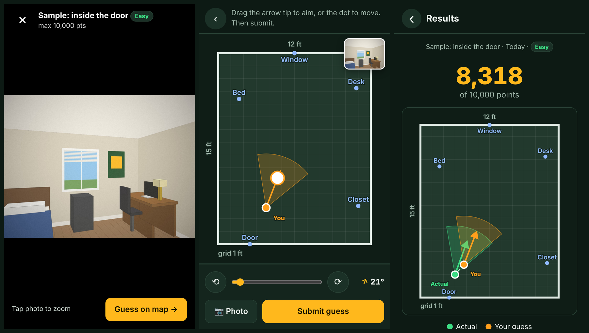

# PolySpot

A GeoGuessr-style game for Cal Poly Pomona. The host takes one photo and marks where they stood and which way the camera faced. The player looks at the photo, taps a spot on the map and aims an arrow. The game scores both the position and the direction.

There are two maps:
- **Cal Poly Pomona campus:** an overhead satellite view (with a street-map toggle) labeled with building names from OpenStreetMap. This is the default.
- **My dorm room:** a to-scale floor plan for testing indoors.

It runs on your laptop, and your phone can play it over the same Wi-Fi. There are no accounts and nothing goes to the cloud. Data is kept in `data/db.json` and `data/photos/`.

**Internet:** the campus map's satellite/street tiles load from Esri and OpenStreetMap on whichever device shows the map. Building names are downloaded once by the laptop. The dorm floor plan works fully offline.



## Run it

You need [Node.js](https://nodejs.org) 20 or newer. There are no dependencies, so you don't need `npm install`.

```bash
cd polyspot
npm start
```

```
  PolySpot is running

  On this laptop:   http://localhost:3000
  On your phone:    http://192.168.1.23:3000   (same Wi-Fi)
```

- **Laptop:** open `http://localhost:3000`.
- **Phone:** join the same Wi-Fi as the laptop and open the "On your phone" address. You can also scan the QR code shown on the laptop's home page.

The first run loads sample data: the campus map, a 12 × 15 ft dorm-room map, and one sample round in the dorm dated today. On start, the server also fetches campus building names from OpenStreetMap (it prints `Loaded N building/place names…`). If the laptop was offline, it retries on the next start, or you can use **Edit map → Import building names**.

| Command | What it does |
|---|---|
| `npm start` | Start the server (HTTP on 3000, and HTTPS on 3443 if certs exist) |
| `npm run dev` | Same, restarting when files change |
| `npm test` | Run the tests (scoring, geometry, API) |
| `npm run cert` | Make HTTPS certificates for the phone compass (see below) |
| `npm run reset` | Delete all local data. The next start loads the sample again |

You can change the defaults with environment variables `PORT`, `HTTPS_PORT`, `HOST` (default `0.0.0.0`) and `DATA_DIR`.

### Phone can't connect?
- **Firewall:** let Node accept incoming connections. macOS and Windows ask the first time; if you clicked "Deny", allow it in the firewall settings.
- **Campus/dorm Wi-Fi often blocks device-to-device traffic** (client isolation). If the phone times out, turn on your phone's hotspot, connect the laptop to it, restart, and use the new address it prints.
- Use the `192.168…` / `10.…` address, not `localhost`. `localhost` on the phone means the phone itself.

## Phone compass (optional) and HTTPS

The host can tap **🧭 Use phone compass**: the arrow then follows the direction the phone's back camera points, and you tap **Lock** to keep it. You can always set the direction by hand instead, by dragging the arrow or using the slider.

Browsers only allow the compass on secure pages. `http://localhost` counts as secure, but `http://192.168.x.x` on your phone does not. **iPhone needs HTTPS** plus a permission tap, and Android Chrome needs HTTPS too.

1. Run `npm run cert` and restart `npm start`. It now also prints `https://192.168.x.x:3443`.
2. Open that HTTPS address on the phone. How you get past the certificate warning depends on how the cert was made:
   - **mkcert (recommended):** install [mkcert](https://github.com/FiloSottile/mkcert) (`brew install mkcert`, `choco install mkcert` or `scoop install mkcert`), then run `mkcert -install` once before `npm run cert`. Then trust the mkcert root on the iPhone once: AirDrop `rootCA.pem` (the script prints its path) → Settings → General → VPN & Device Management → install, then Settings → General → About → Certificate Trust Settings → turn it on. After that there's no warning.
   - **openssl fallback:** if mkcert isn't installed, the script makes a self-signed cert. On the phone, tap *Show Details → visit this website* (iPhone) or *Advanced → Proceed* (Android). If the compass is still refused, use mkcert.
   - **Android only, no certs:** in Chrome open `chrome://flags/#unsafely-treat-insecure-origin-as-secure`, add `http://192.168.x.x:3000` and relaunch.
3. If your laptop's IP changes (a new network), run `npm run cert` again.

**Map alignment.** A compass gives degrees from north, but "up" on your floor plan probably isn't north. In **Edit map → Compass alignment**, stand inside, point the camera at the top wall of the map and lock. After that, compass readings convert to map headings. Indoor compasses are often off by 10–20° because of steel and electronics, so fine-tune with the slider.

## How to play

1. **Edit the map** (`📐`). Use the dropdown at the top to switch maps.
   - **Campus:** the dashed box is the play area; guesses can't go outside it. Pan or zoom to the area you want, then tap **Use current view as play area**. Re-import or rename building labels, add your own (a fountain, a garden…), and choose feet or meters for distances. The layers button switches between Satellite and Map and hides labels. Labels appear as you zoom in.
   - **Dorm floor plan:** enter width and length in feet or meters (there's a toggle). The plan is drawn to scale with a grid. Add labeled features (door, bed, desk…) and tap where each one is.
2. **Host a round** (`📷`):
   - Take a photo (opens the camera) or choose one. The photo is shrunk to about 0.5 MB in the browser and its EXIF/GPS data is removed.
   - Pick the map (the app remembers your last choice).
   - **Campus:** pinch to zoom, **tap where you stood**, then drag the **white ring** to aim. Drag the dot to move it.
   - **Floor plan:** **tap where you stood and drag toward where the camera pointed**. Drag the dot to move it, or the arrow tip to re-aim it.
   - On either map, the slider and the ⟲/⟳ buttons fine-tune the direction. On campus, north is up, so the phone compass needs no alignment.
   - Pick a difficulty (Easy, Hard, Nighttime or Impossible) and a release date (default today). Then save.
3. **Play** (`▶`): this opens today's round. The full list under **All rounds** lets you pick any round for testing. The photo shows full screen (tap it to zoom). Tap **Guess on map →**, place yourself and aim the same way as the host, then submit.
4. **Results:** the map zooms to show both positions and both view cones, with a dashed line between the positions. You also get the distance error, the angle error (shortest difference, 0–180°), the points, and your guess history for that round. Tap a past guess to see it on the map.

The answer never leaves the server until a guess has been made for that round.

## Scoring

All scoring settings are in **[`shared/scoring.config.js`](shared/scoring.config.js)**. The server uses it to score guesses and the browser uses it for labels.

```
position  = 5000 × exp(−distance / scale)
            scale = mapDiagonal × scaleFraction (0.15) × difficulty.scale
direction = 5000 × (1 − angleError / 180)
total     = (position + direction) × difficulty.multiplier   (if useDifficultyMultiplier)
```

| Difficulty | scale (more forgiving on distance) | multiplier | max |
|---|---|---|---|
| Easy | 1.0 | ×1 | 10,000 |
| Hard | 1.3 | ×1.25 | 12,500 |
| Nighttime | 1.6 | ×1.5 | 15,000 |
| Impossible | 2.0 | ×2 | 20,000 |

Examples on Easy:
- **Dorm (12 × 15 ft):** the scale is about 2.9 ft. A guess 1 ft off gets about 3,530 position points; 3 ft off gets about 1,770.
- **Campus (default play area, about 3 km across):** the scale is about 450 m. A guess 50 m off gets about 4,470 points, 100 m off about 4,000, and 300 m off about 2,560. For a tougher campus game, lower `scaleFraction` (0.05 gives a scale of about 150 m) or shrink the play area.

## Project layout

```
polyspot/
├── server.js               starts HTTP (+HTTPS), binds 0.0.0.0, prints the LAN URLs
├── src/
│   ├── app.js              JSON API + static files (no framework)
│   ├── store.js            data/db.json + data/photos/, seeding on first run
│   ├── osm.js              building names from OpenStreetMap (Overpass API)
│   └── net.js              finds the laptop's LAN IPs
├── shared/                 used by the server AND the browser
│   ├── scoring.config.js   ← all scoring knobs
│   ├── scoring.js          scoring formulas
│   └── geo.js              coordinate systems: floorplan {x,y} meters, latlng {lat,lng}
├── public/
│   ├── index.html, style.css
│   ├── vendor/             Leaflet 1.9.4 (BSD-2), QR code generator (MIT)
│   └── js/
│       ├── app.js          hash router
│       ├── map/index.js    map adapter interface + registry
│       ├── map/floorplan.js  SVG floor-plan adapter (to-scale rectangle)
│       ├── map/leaflet.js  satellite/street map adapter (campus, lat/lng)
│       ├── compass.js      DeviceOrientation (iOS + Android)
│       ├── photo.js        camera/file → resized JPEG
│       ├── components.js   heading slider, difficulty chips, compass button…
│       └── views/          home, host, play, results, rounds, map editor
├── seed/                   sample map + round (copied to data/ on first run)
├── scripts/                make-cert.js, reset.js
└── test/                   node --test
```

### API

| Method | Path | |
|---|---|---|
| GET/POST | `/api/maps` | list / create a map |
| GET/PUT | `/api/maps/:id` | read / update a map |
| POST | `/api/maps/:id/import-osm` | refresh a campus map's building names from OpenStreetMap (keeps your own labels) |
| GET/POST | `/api/rounds` | list rounds (without the answer) / create (photo as a data URL) |
| GET | `/api/rounds/today?date=YYYY-MM-DD` | newest round released on that date |
| GET/DELETE | `/api/rounds/:id` | |
| GET/POST | `/api/rounds/:id/guesses` | history (+ answer once guessed) / submit `{ pos, heading }` |

### Map types

Views never touch SVG or Leaflet directly. They call the map adapter interface in `public/js/map/index.js`, and scoring only calls `shared/geo.js`. Each map's `type` picks both:

| `type` | Adapter | Positions | Heading 0° |
|---|---|---|---|
| `floorplan` | `map/floorplan.js` (SVG) | `{ x, y }` meters from the top-left corner | top of the plan |
| `latlng` | `map/leaflet.js` (Leaflet) | `{ lat, lng }` | true north |

A `latlng` map has a play area, `bounds: { sw, ne }`. To add another real place (say, a second campus), create one with the API or copy the campus entry in `data/db.json` with new bounds.

## Suggested next steps

1. **Offline campus map:** cache the satellite tiles for the play area on the laptop, so the campus works without internet.
2. **Daily release:** hide rounds dated in the future from players, allow one scored guess per day per player (practice guesses unscored), and add a countdown to the next round. `date` is already stored and `/api/rounds/today` exists.
3. **Players and leaderboard:** start with a nickname stored on the phone (no accounts), then daily/weekly leaderboards and streaks.
4. **Multiplayer:** add a room code, then everyone guesses the same round on their own phone, and results show all guesses together (WebSocket or polling).
5. **Hosting for friends:** run it on a small always-on box (Raspberry Pi) or a cheap VPS with real HTTPS, and move storage to SQLite.
6. **Better photos:** pinch-zoom, an optional time limit, and blur tools for faces and room numbers.
7. **Host tools:** edit or move a round after saving, preview the score heat-map, and back up/restore `data/`.
